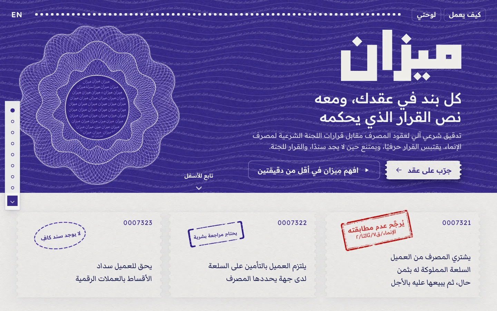
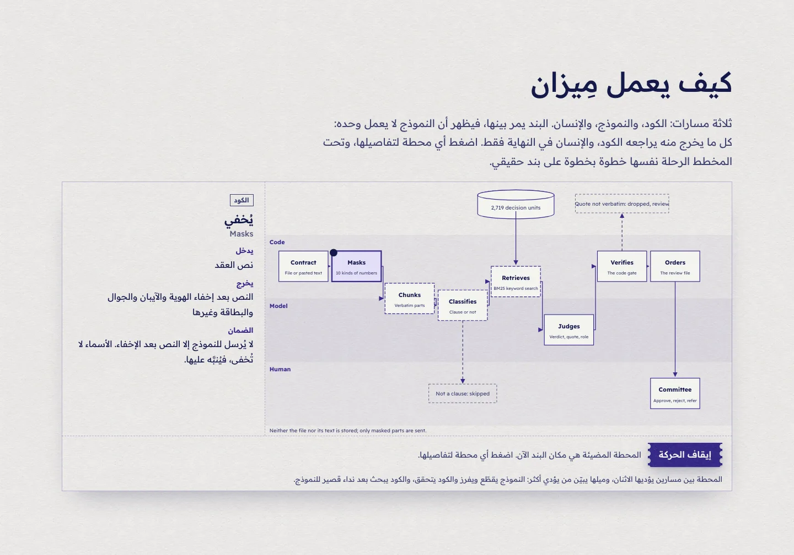
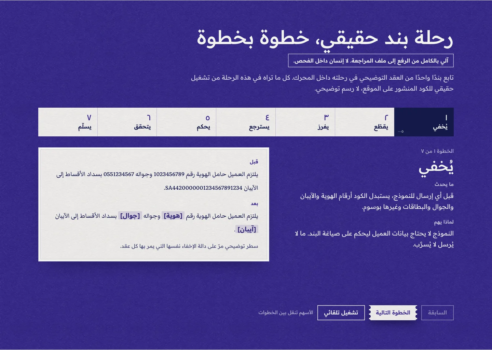
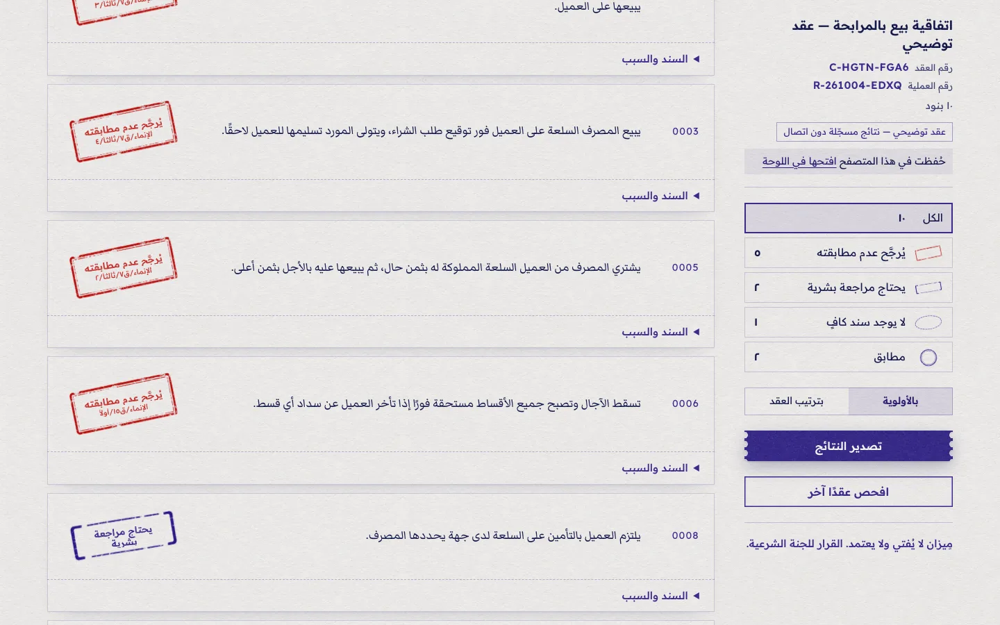

# مِيزان · Mizan

**كل بند في عقدك، ومعه نص القرار الذي يحكمه.**
مساعد تدقيق شرعي يفحص بنود عقود المصرف مقابل قرارات اللجنة الشرعية لمصرف الإنماء. لكل بند حكم، ومعه نص القرار حرفيًا بمعرّفه. وحين لا يجد سندًا يقول ذلك. مِيزان لا يفتي ولا يعتمد، والقرار للجنة الشرعية.

🏆 **المركز الأول، هاكاثون VentureX 2026** (مسار الذكاء الاصطناعي والبيانات، جامعة الملك سعود)، فريق مِداد.

- النموذج الأولي: **[mizansharia.com](https://mizansharia.com)**
- كيف يعمل: [mizansharia.com/how](https://mizansharia.com/how)
- أنميشن يشرح مِيزان في أقل من دقيقتين: [Google Drive](https://drive.google.com/file/d/1GNz0tQFj6LfB9eAdJ9dYXEPdi2Ca4jsS/view?usp=sharing)



*English version below.*

---

## المشكلة

لا يُطلق منتج في المصرف الإسلامي قبل أن تراجع اللجنة الشرعية عقوده. والمدقق يراجع كل بند مقابل أكثر من 1500 قرار. وإذا وجد بندًا مخالفًا، رجع العقد للفريق، ثم يُراجَع من جديد. والصعوبة الأكبر أن لغة العقد غير لغة القرار: البند يصف «بيع العينة» دون أن يقول كلمة «عينة»، فلا يجده البحث بالكلمة.

## كيف يعمل

محرك واحد بخطوات ثابتة مكتوبة في الكود. والنموذج اللغوي أداة يستدعيها المحرك في مواضع محددة، ولا يقرر الخطوات بنفسه.



| الخطوة | من يؤديها | ماذا يحدث |
|---|---|---|
| **يُخفي** | الكود | أرقام الهوية والجوال والآيبان والبطاقات وغيرها تصير وسومًا قبل أي إرسال |
| **يقطّع** | النموذج والكود | أجزاء منسوخة حرفيًا. الكود يرفض أي جزء غير حرفي، ويعيد ما أسقطه النموذج |
| **يفرز** | النموذج والكود | بند، أو تمهيد مع بنوده، أو «ليس بندًا» (عنوان، أو مصدر، أو توقيع) |
| **يسترجع** | الكود بعد نداء قصير للنموذج | النموذج يضيف للبند مصطلحاته الفقهية، ثم بحث **BM25 بالكلمات** في 2719 وحدة، على نسختين من الفهرس |
| **يحكم** | النموذج | يقرأ البند والمرشحين فقط، ويعيد حكمًا واقتباسات ودور كل اقتباس |
| **يتحقق** | الكود | كل اقتباس من المرشحين، وحرفي في نص القرار. ولا «مخالف» بلا منع أو شرط صريح |
| **يرتّب** | الكود | ملف مراجعة بالأولوية، برقم عقد ورقم عملية، ويُصدَّر إلى PDF وWord وExcel |

ثم **اللجنة تقرر** على كل ملاحظة: اعتماد، أو رفض، أو إحالة.



### الاسترجاع بالتفصيل
- **توسيع السؤال** (`src/server/engine/query.ts`): يطلب الكود من النموذج 3 إلى 8 مصطلحات فقهية للبند، مثل «بيع العينة» و«الوعد الملزم»، ويضمها إلى نص البند قبل البحث.
- **توسيع الوثائق** (`src/server/engine/enrich.ts`): مرة واحدة قبل التشغيل. لكل وحدة قرار: نوعها (منع، أو شرط، أو إجازة…)، ونطاقها، وجمل قصيرة تصف الصورة نفسها بلغة العقود.
- **BM25** (`src/server/engine/bm25.ts`): على نسختين، النص كما هو، والنص مع جمل الإثراء. نأخذ 12 من كل نسخة، فيصل نحو 17 مرشحًا إلى خطوة الحكم.
- **قسنا البدائل** على 90 بندًا: البحث الدلالي وحده أضعف، والهجين أفضل ببندين فقط، وإعادة الترتيب أسوأ. التفاصيل في `eval/retrieval/`.

## القياس، مع حدوده

على مجموعة اختبار بنيناها من نصوص القرارات (15 عقدًا، و91 بندًا مقيسًا). الأرقام بندًا بندًا على 70 بندًا اصطناعيًا، مقابل البحث بالكلمة وحده:

| | مِيزان | البحث بالكلمة وحده |
|---|---|---|
| يلتقط المخالف | 93% | 68% |
| الدقة | 96% | 48% |
| إنذار كاذب على المطابق | 0% | 49% |
| صحة الاستشهاد | 91% | 70% |

وعلى العقود كاملة كما يفحصها الموقع: 96% على العقود الاصطناعية، و71% على 4 عقود حقيقية منشورة (21 بندًا). والثبات بين تشغيلين 94%.

**حدود القياس:** العقود الاصطناعية ومراجعة مفتاح إجاباتها من Claude، لا من مختص شرعي، فالأرقام غالبًا متفائلة. والعقود الحقيقية قليلة. ولم ندرّب نموذجًا: المعرفة في القرارات وقواعد الكود.



## التشغيل محليًا

```bash
npm install

# 1) المدونة: تُبنى محليًا ولا تُرفع إلى git (نصوص القرارات مملوكة لمصرف الإنماء)
python3 tools/corpus/fetch_alinma.py            # يكتب data/corpus/decisions.jsonl و units.jsonl

# 2) فهرس الإثراء (اختياري، يحتاج ANTHROPIC_API_KEY، دفعة Batch لكل الوحدات)
npm run enrich                                   # يكتب data/enrichment.jsonl

# 3) الموقع
echo "ANTHROPIC_API_KEY=..." > .env.local
npm run dev                                      # http://localhost:3000/ar
```

- **بلا مفتاح:** الموقع يعمل، و`/review?offline` يعرض العقد التوضيحي بنتائج مسجّلة.
- **النموذج إعداد:** `MIZAN_LLM_PROVIDER` و`MIZAN_LLM_MODEL` و`MIZAN_LLM_BASE_URL` و`MIZAN_LLM_API_KEY` تبدّل Claude بأي خادم متوافق مع OpenAI، ومنها نموذج مفتوح المصدر على خوادم المصرف.
- **الحماية على الخادم:** `MIZAN_ACCESS_CODE` و`MIZAN_DAILY_USD` و`MIZAN_RATE_PER_HOUR`.
- **الفحوص:** `npm test` (176 اختبارًا)، و`npm run lint`، و`npm run check:claims`، و`npm run build && npm run check:leak`. الأخير يتأكد أن نصوص القرارات لا تصل إلى ملفات المتصفح.
- **ملاحظة:** اختبارات المحرك وفحص `tools/check-content.mjs` تحتاج المدونة في `data/corpus/`. وأدوات `tools/eval/` تحتاج مجموعة الاختبار، وهي غير منشورة هنا.

## التقنية

Next.js 16 (App Router)، وReact 19، وTypeScript، وTailwind 4، على Vercel. وClaude Sonnet 5.5 عبر API، والنموذج قابل للتبديل. والمدونة ملفات JSONL في ذاكرة الخادم، بلا قاعدة بيانات. والبحث BM25 مكتوب يدويًا.

```
src/server/engine/   المحرك: redact, split, structure, query, bm25, judge, verify, pipeline
src/app/[lang]/      الصفحات بالعربي والإنجليزي، و api/review
src/components/      الواجهة: review, how, flow, hero, sections
src/content/         نصوص الموقع، والعقد التوضيحي، والاقتباسات القصيرة المعروضة
tools/               فحوص المحتوى والادعاءات والتسريب، والقياس، وبناء المدونة
eval/                نتائج القياس
DESIGN.md            نظام التصميم
```

## البيانات والحقوق

نصوص قرارات اللجنة الشرعية مملوكة لمصرف الإنماء، ومنشورة على [صفحة الإصدارات الشرعية](https://alinma.com/About-the-Bank/Shariah-Board/Sharia-Committee-Releases). هذا المستودع **لا يحوي المدونة**، وفيه فقط اقتباسات قصيرة حرفية بمعرّفاتها مما يعرضه الموقع، لاستخدام غير تجاري. ولا ادعاء بأي اعتماد أو شراكة مع مصرف الإنماء.

الكود © 2026 فريق مِداد. جميع الحقوق محفوظة.

## فريق مِداد

| | |
|---|---|
| **مازن فهد بن خنيزان** · [@mz2x](https://github.com/mz2x) | قائد الفريق: المحرك، والقياس، والموقع، وتجربة الاستخدام |
| **فيصل عبدالمجيد الشايع** · [@faisalaas2018-hub](https://github.com/faisalaas2018-hub) | تعريف المنتج، وقصة العرض، ومنهجية مجموعة الاختبار |
| **أحمد تيسير العفيصان** · [@AhmadAlofisan](https://github.com/AhmadAlofisan) | المدونة، وبنود الاختبار من القرارات، والاختبار اليدوي |

---

# English

**Every clause in your contract, with the ruling that governs it.**
Mizan is a Sharia-review assistant for bank contracts. It checks each clause against the published decisions of the Alinma Bank Sharia committee. Each clause gets a verdict with the decision text quoted verbatim and its ID, and Mizan abstains when it finds no basis. It never issues a fatwa or an approval: the committee decides.

🏆 **1st place, VentureX 2026 hackathon** (AI & Data track, King Saud University), team Midad: Mazen Bin Khunaizan ([@mz2x](https://github.com/mz2x)), Faisal Alshaya ([@faisalaas2018-hub](https://github.com/faisalaas2018-hub)) and Ahmad Alofisan ([@AhmadAlofisan](https://github.com/AhmadAlofisan)).

Live prototype: **[mizansharia.com](https://mizansharia.com)** · How it works: [/how](https://mizansharia.com/how)

## How it works
One engine with fixed steps written in code. The LLM is called at defined points and never chooses the steps.

**Masks → Chunks → Classifies → Retrieves → Judges → Verifies → Orders**, then the committee approves, rejects or refers each finding.

- **Retrieval is BM25 keyword search, not semantic search.** First the model adds 3 to 8 fiqh terms to the clause (query expansion). Each decision unit was enriched offline with short contract-style phrasings (document expansion). BM25 runs over the plain and the enriched index, 12 hits each, so about 17 candidates reach the judge.
- **The code gate** drops any quote that is not verbatim or not among the candidates. It also allows no "non-compliant" verdict without an explicit prohibition or condition.
- **We measured the alternatives** on 90 clauses: semantic-only was weaker, hybrid was better by 2 clauses, and a reranker was worse (`eval/retrieval/`).

## Results, with their limits
On 70 synthetic clauses, against keyword search alone:

| | Mizan | Keyword search alone |
|---|---|---|
| Recall on non-compliant clauses | 93% | 68% |
| Precision | 96% | 48% |
| False alarms on compliant clauses | 0% | 49% |
| Citation accuracy | 91% | 70% |

On whole contracts: 96% on synthetic contracts, and 71% on 4 real published contracts (21 clauses). Run-to-run stability is 94%. The synthetic contracts and the answer-key review were done by Claude, not a Sharia scholar, so treat these numbers as optimistic. No model was trained.

## Run locally
See the commands above. The Alinma decision corpus is **not** in this repository. Build it with `python3 tools/corpus/fetch_alinma.py`. Without an API key, `/review?offline` shows the demo contract with recorded results.

## Data and rights
The decision texts belong to Alinma Bank. This repository contains only the short verbatim excerpts the site displays, for non-commercial use, and claims no endorsement by or partnership with Alinma Bank. Code © 2026 Team Midad. All rights reserved.
